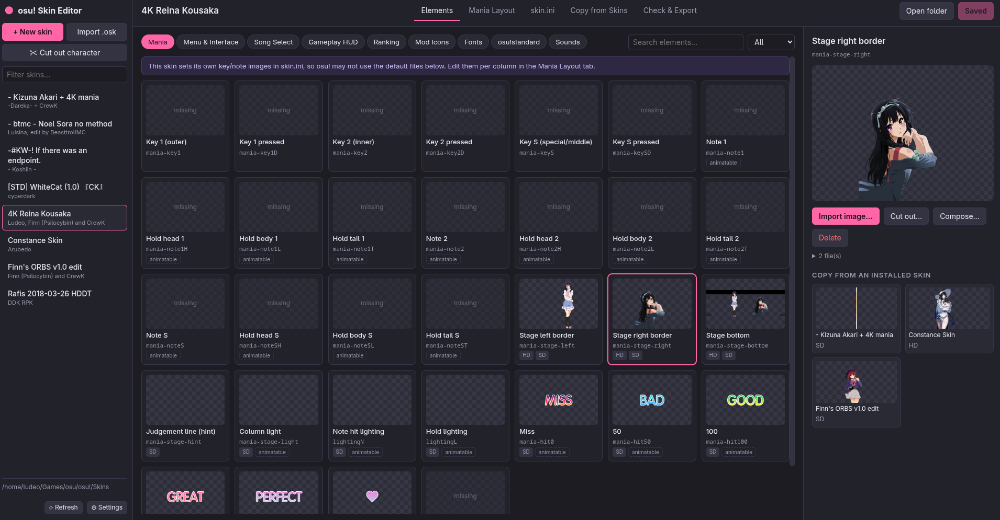
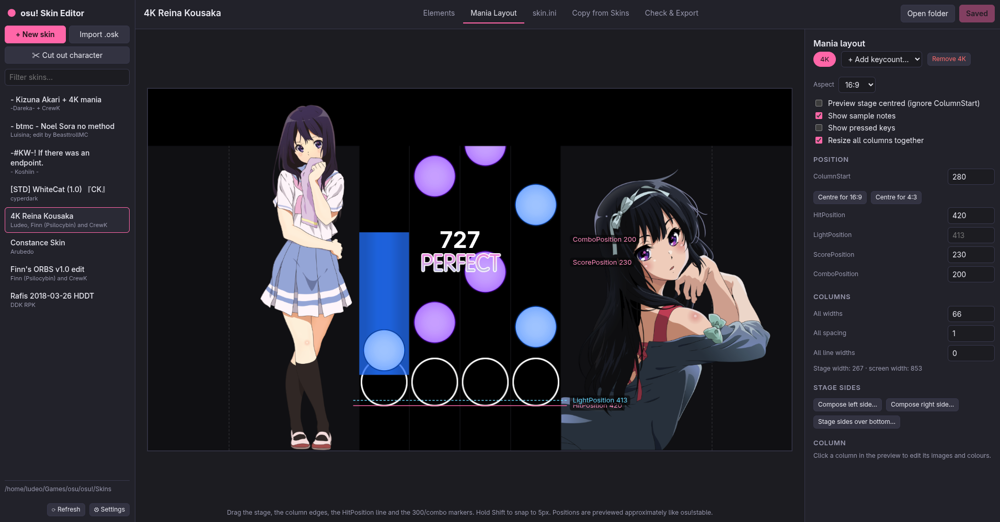
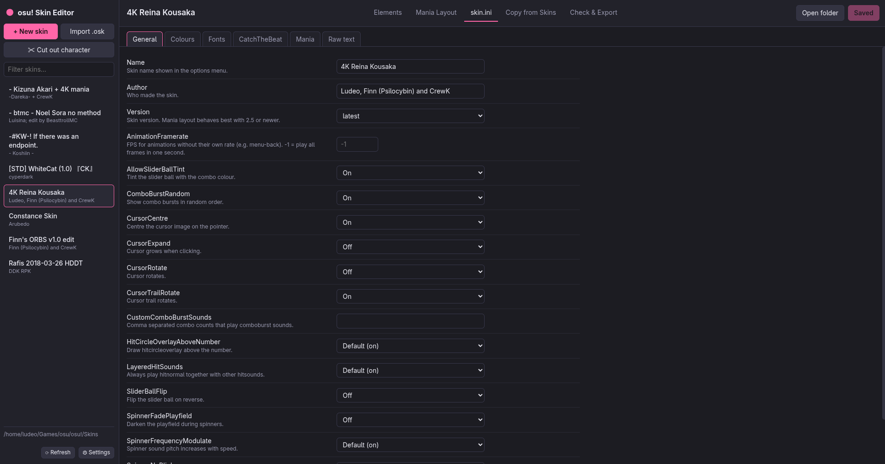
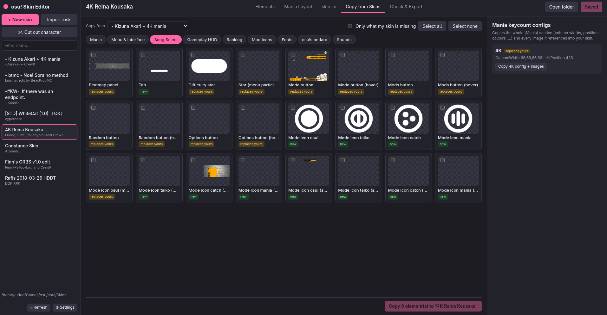
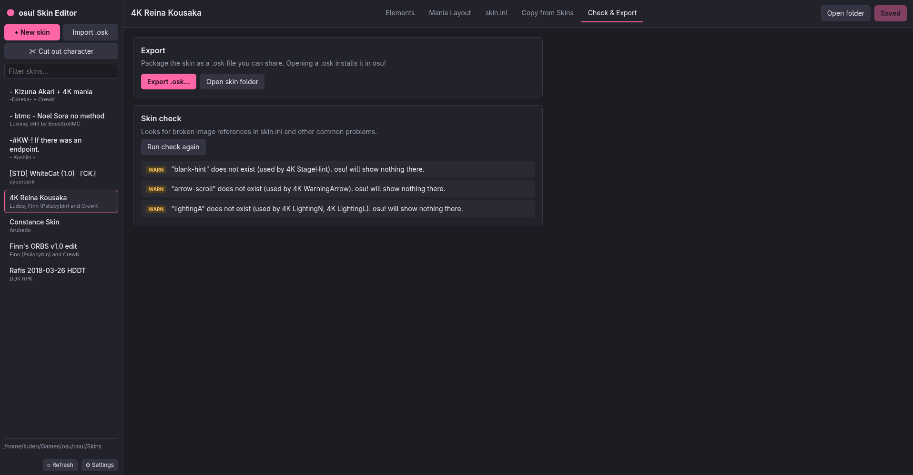

> [!IMPORTANT]
> This app is 100% made by AI (Opus 5.5 Medium Effort)

# osu! Skin Editor

A desktop app (Electron) that makes building osu! skins — especially **osu!mania** skins — much faster.

## Preview







## Features

- **Element browser.** Every skinnable image and sound, grouped by category (Mania, Menu, Song Select, HUD, Ranking, Mods, Fonts, Standard, Sounds). Each card shows a preview and whether the element has HD (`@2x`), SD and animation frames. Drop a file onto a card to replace that element.
- **Copy from installed skins.**
  - The detail panel shows every installed skin that has the selected element. Click one to copy it, including all `@2x` variants and animation frames.
  - The *Copy from Skins* tab copies many elements at once.
  - It can also copy a whole mania keycount config (`[Mania]` section) along with every image it references.
- **GIF / video → skin frames.** Import a GIF, WebM, MP4, etc. into an animatable element (menu-back, hit bursts, lighting, notes, …). ffmpeg extracts the frames as `name-0.png … name-N.png`. You can set the start time, duration, FPS, max frames and output size, and generate both `@2x` and SD versions. Transparent WebM (VP8/VP9 alpha) is supported. Static elements take one frame (or a converted image).
- **Results panel composer.** Under Ranking → Results panel → *Compose…*: stack the current panel, panels from other skins and your own images (e.g. a character with a transparent background) as layers. Move, scale, rotate, mirror and fade them on a canvas of any size, e.g. 2732×3400 to cover the area you scroll down to on the results screen, like the Constance skin does. Undo/redo, screen guides and drag & drop are supported. Saving writes `ranking-panel@2x.png` (+ an optional SD copy). The layers are kept in the app's data folder, so you can rearrange them later. The same composer is available for the mania stage sides, the stage bottom and the song select beatmap panel (Song Select → Beatmap panel, `menu-button-background`, 1398×206). For a lane cover drawn in `mania-stage-bottom`, *Add stage sides…* paints `mania-stage-left`/`-right` into it exactly where osu! draws them, so the cover doesn't hide them.
- **Character cut-out.** *✂ Cut out character* in the sidebar, *Cut out…* on any image element, or *+ Cut out character…* in the composer: pick a picture and remove its background to get a transparent PNG. *Detect character* runs an AI model (IS-Net from the [rembg](https://github.com/danielgatis/rembg) project, one for anime/illustrations and one for photos). Each model is downloaded once (~170 MB) into the app's data folder and runs offline on your computer. Clean up the result with the erase/restore brushes, a magic wand for plain backgrounds, "Remove loose specks", and edge shrink/soften. Borders are trimmed on save.
- **skin.ini editor.**
  - Forms for `[General]`, `[Colours]`, `[Fonts]`, `[CatchTheBeat]` and every `[Mania]` keycount: colour pickers with alpha, on/off/default toggles, dropdowns and image pickers with thumbnails.
  - A per-column table covers widths, spacing, images and colours.
  - A raw text mode is also available.
  - Unknown keys and comments are kept. A `skin.ini.bak` is written before the first save in each session.
- **Visual mania layout editor.** Drag the stage (`ColumnStart`), column edges (`ColumnWidth`), the judgement line (`HitPosition`), `LightPosition`, and the 300/combo markers (`ScorePosition`, `ComboPosition`). The preview shows the skin's real key, note, hold, stage and judgement images. Click a column to change its images and colours. Has 16:9 / 16:10 / 4:3 / 21:9 previews and "centre stage" helpers.
- **Check & Export.** Finds skin.ini references to images that don't exist, then packages the skin as `.osk`. You can also import `.osk` files.

## Requirements

- Node.js 20+
- **ffmpeg** on your `PATH` (used for GIF/video/image conversion). Alternatively, allow the optional bundled binary with `npm install-scripts approve ffmpeg-static && npm rebuild ffmpeg-static`, or set a custom path in Settings.

## Run

```bash
npm install
npm start        # or: npm run dev  (opens DevTools)
npm test         # unit tests (ini parser, element matching, copying, ffmpeg conversion)
```

## Linux build

```bash
npm run build:linux   # dist/osu-skin-editor-<version>-x86_64.AppImage and -x64.tar.gz
npm run build:dir     # unpacked app only, in dist/linux-unpacked (faster, for testing)
```

The AppImage runs on its own (`chmod +x` it first). Unpack the tarball anywhere and run `./osu-skin-editor`. ffmpeg is not bundled, so the target machine needs it on `PATH`, unless `ffmpeg-static` was approved (see Requirements) before building, in which case its binary is packed in.

## Windows build

```bash
npm run build:win     # dist/osu-skin-editor-<version>-setup.exe (installer) and -portable.exe
```

This also works from Linux. The script downloads `ffmpeg.exe` into `node_modules/ffmpeg-static` first, so the Windows build always includes ffmpeg. The exe is not code-signed, so SmartScreen will warn on first start ("More info" → "Run anyway").

On first start the app looks for your osu! `Skins` folder (Windows `%LOCALAPPDATA%\osu!\Skins`, common Wine/Lutris/osu-winello locations on Linux). If it isn't found, choose it in **Settings**.

## Notes

- The layout preview is an approximation of osu!stable's renderer. It uses osu!'s 480px-tall coordinate space, and skin images are drawn at the 1024×768 skin pixel scale (`@2x` files at half size). Always confirm in-game.
- osu!stable may centre single stages regardless of `ColumnStart`. Toggle *Preview stage centred* to see that case.

## Project layout

```
src/main/      Electron main process: IPC, file ops (skinFs.js), ffmpeg (media.js), saved compositions (compose.js), background removal (cutout.js)
src/shared/    Code shared by main + renderer: skin.ini parser, element catalog, ini schema
src/renderer/  UI (plain ES modules, no build step): views/ per tab, lib/ helpers
test/          node:test unit tests
```
